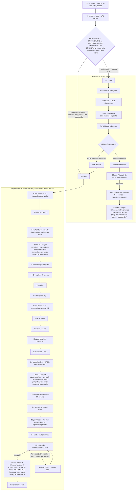

# Fluxo completo — sustentação + implementação

**Ponto de entrada único** para cards e incidentes. Detalhes por fase nos guias linkados.

Índice geral: [README.md](README.md).


---

## C0 — Busca do card no ADO (primeiro passo ao receber número de card)

**Ao receber qualquer número de card**, o agente busca automaticamente o work item no Azure DevOps antes de qualquer outra ação.

| Item | Detalhe |
|------|---------|
| Ferramenta | `mcp__azure-devops__wit_work_item` |
| Campos lidos | Título, Descrição, Critérios de aceite, Estado, Tipo, Tags |
| Saída | Resumo no chat: número, título, tipo, estado, ACs |
| Exceções | Usuário confirma que já descreveu a demanda e dispensa a busca |

**Após C0:** prosseguir com L0.

---

## L0 — Ambiente local (obrigatório antes de B0)

**Primeira etapa de todo card após C0:** subir aplicação + BD local, validar HTTP e **informar a URL de acesso no chat**. Somente após L0 ok → **B0 (bifurcação)** e, conforme a resposta, **S1** ou **I1**.

| Item | Detalhe |
|------|---------|
| Guia | o perfil `.cursor/arquitetura/ambiente-local-{projeto}.md` — seção **Gate L0** |
| Modo | Agent (infra local) — **não** substitui S1–S6 |
| Saída | MySQL `127.0.0.1:3309` ok + **URL local no chat** |

**Exceções:** pergunta conceitual sem card; usuário confirma que L0 já está ok.

---

## B0 — Bifurcação (obrigatória, após L0 ok)

**Somente após L0 estar operacional**, o agente pergunta no chat e **aguarda resposta explícita** do usuário:

> Qual é o tipo de tarefa: **SUSTENTAÇÃO** ou **IMPLEMENTAÇÃO**? Proponho a **trilha CURTA|COMPLETA**
> porque <critério de § *Trilhas* que bateu, ou "nenhum critério de completa bateu">. Confirma?

O agente **propõe** a trilha pelo critério objetivo de § *Trilhas* e o usuário confirma junto com o
tipo. Sem confirmação explícita da trilha, vale a **completa**.

| Item | Detalhe |
|------|---------|
| Pré-requisito | **L0 ok** — app + BD no ar e URL informada no chat |
| Saída | Tipo de tarefa **e trilha** confirmados **pelo usuário** — registrar com `fase.sh B0 <card> --trilha curta|completa` |
| Modo | Plan |

| Resposta do usuário | Caminho | Ação do agente |
|---------------------|---------|----------------|
| **“é sustentação”** | **Fluxo A** — S1–S6 | Iniciar **S1** na **mesma aba** — aba única por card; abrir aba só se o medidor cobrar |
| **“é implementação”** | **Fluxo B** — I1–I15 da trilha | **Confirmar antes:** “Confirma que pula S1–S6 e vai direto para o plano? (Y/n)”. Só com o **sim**, iniciar **I1** na **mesma aba** |

**Proibido:**

- Iniciar **S1** ou **I1** antes de **L0** estar operacional.
- Iniciar qualquer fluxo **sem** a resposta explícita da bifurcação (não presumir o tipo de tarefa).
- Ir direto para **I1–I15** sem a confirmação **(Y/n)** de que S1–S6 estão sendo pulados.

**Regra dos cards:** C0 (busca ADO) → L0 (ambiente local) → **B0 (bifurcação + trilha)** → **Fluxo A (S1–S6)** ou **Fluxo B (I1–I15)**, cada um na trilha curta ou completa. No Fluxo A, a implementação **I1–I15** ocorre somente quando **S5** registrar **implementação necessária** — quem decide entre análise suficiente e implementação é o **agente**, com base na análise. O Fluxo B direto existe **apenas** quando o usuário declara implementação em B0 e confirma pular S1–S6.

---

## Trilhas — curta e completa

O tamanho do processo acompanha o **custo de errar**, não o hábito. A trilha é proposta pelo
agente no B0, confirmada pelo usuário e registrada em `fase.sh B0 <card> --trilha <t>`.

### Critério objetivo — qualquer item marcado leva à COMPLETA

| # | Critério | Como verificar |
|---|---|---|
| 1 | Efeito em dinheiro: cobrança, valor, desconto, ganho, estorno, vencimento | classe `dinheiro`/`concorrencia` de `frota.sh gatilhos` |
| 2 | Dado pessoal, credencial, token ou sessão | classe `dado-sensivel`/`exposicao` |
| 3 | Schema: tabela, coluna, índice, migration | classe `schema` |
| 4 | Contrato público ou integração: rota/endpoint/webhook novo ou alterado, chamada a terceiro | classe `contrato-http`/`terceiro` |
| 5 | Dois ou mais repositórios | plano ou análise lista arquivos em 2+ repos |
| 6 | Mudança grande: estimativa > 5 arquivos ou > 200 linhas de diff | contagem no plano; depois `git diff --stat` |
| 7 | Incidente em produção com cliente afetado agora (sustentação) | card/usuário |

Nenhum marcado → **CURTA**. Em dúvida → **COMPLETA**. **Promoção:** se durante a curta aparecer
artefato de um critério acima (o hook de gatilho dispara a classe), o agente avisa na primeira linha
e o card passa à completa a partir dali — antes do I4, faz `plano.html` + I2-val; depois do I4, faz
I6 + I6-rev + E2E (I7–I9) antes de seguir. Nunca o contrário: completa não rebaixa sozinha.

### O que cada trilha percorre

| | Trilha curta | Trilha completa |
|---|---|---|
| **Sustentação** | S1+S3 numa passada (o fluxo vira seção da análise) → **S4 única** sobre análise **+** `evidencias.html` (substitui S2 e S6a-val) → S5 → S6a → PC → DEST | S1 → S3 → S3-rev → S2-S4 consolidada → S5 → S6a → S6a-val → S6a-pc → DEST |
| **Implementação** | I1 plano curto → **I2-val** (`validador-leve`) → **I4** → I5 → I10 local → **I11** (`evidencias.html` implementação + local; `validador-tecnico` confere **código vs plano + HTML** numa rodada, substitui I6) → Pós-I11 → **I12** → I13 → PC → I14 → I15 → DEST | I1 → I1-rev → I2-html → **I2-val** (única validação do plano, `validador-tecnico`) → Pós-I2-val → I3 → **I4** → I5 → I6 → I6-rev → I7 → I8 → I9 → I10 → I11 → Pós-I11 → **I12** → I13 → I13-pc → I14 → I15 (consolidada com I11 quando couber) → DEST |
| Gates do usuário | **I4** e **I12** | **I4** e **I12** |
| Gatilho por artefato | vale igual (é por artefato, não por trilha) | vale igual |
| PC (Postman) | se houver cenário HTTP; senão `N/A — motivo` | idem |
| Destilação | obrigatória | obrigatória |

Na curta: sem `plano.html`, sem I1-rev formal (os gatilhos que dispararem têm a linha no
`_processo-revisoes.md` como sempre), sem E2E separado do local, sem I6 separado. A sustentação
que termina em S5 = *implementação necessária* segue a **mesma trilha** que foi confirmada no B0.

---

## Diagrama



Trilha curta (implementação): `I1 plano curto → I2-val (leve) → I4 → I5 → I10 → I11 (código + HTML) → I12 → I13 → PC → I14 → I15 → DEST`.

---

## Tabela mestra — etapas, modos e gates

| Etapa | Nome | Modo | Entrega principal | Validação subagente | Critério de saída |
|-------|------|------|-------------------|---------------------|-------------------|
| **C0** | Busca ADO | Agent | Resumo do card no chat (título, ACs, estado) | Não | Card compreendido antes de L0 |
| **L0** | Ambiente local | Agent | URL no chat + BD ok | Não | App e MySQL locais acessíveis |
| **B0** | Bifurcação | Plan | Pergunta no chat: *SUSTENTAÇÃO ou IMPLEMENTAÇÃO?* | Não | **Resposta explícita** do usuário · se “implementação”, também o **(Y/n)** confirmando pular S1–S6 |
| **S1** | Fluxo | Plan | `docs/fluxos/{tipo}/{card-id}.md` (curta: seção da análise) | Sim (S2-S4 consolidada) | `Status: Aprovado` no fluxo |
| **S2** | Validação do fluxo | Plan | — | Rodada concluída | — |
| **S3** | Análise + HTML | Plan | `docs/analises/{tipo}/{card-id}.md` + `evidencias.html` (diagnóstico) | Sim (S4) — `validador-tecnico` (Opus) | Causa raiz 100% + HTML coerente |
| **S3-rev** *(completa)* | Revisões de especialistas (análise) | Plan | `## Revisões de especialistas` no **`_processo-revisoes.md` interno** (não no `.md` da análise — regras.md § 11) | Não — especialistas **por gatilho** | Todo gatilho disparado com veredito registrado · os que não dispararam em **uma linha** |
| **S4** | Validação da análise | Plan | — | Rodada concluída (curta: análise **+** `evidencias.html`, substitui S2 e S6a-val) | — |
| **S5** | Decisão do agente | Plan | Seção `## Decisão de implementação` no `.md` da análise | Não | **Análise suficiente** **ou** **implementação necessária** |
| **S6a** | Encerramento | Plan | Recomendações no chat | Não | Sem código; ciclo I **não** se aplica |
| **S6a-val** *(completa)* | Validação do HTML final | Plan | — | **Sim** — `validador-tecnico` (Opus) | `evidencias.html` consolidado com `Status: Aprovado` — **antes** da entrega |
| **S6a-pc** | Collection Postman dos cenários (ou `N/A — motivo`) | Plan | Postman collection no **workspace do Luiz** — `especialista-postman` (Sonnet) — request + asserts para cada cenário investigado/reproduzido, apontando para homol | Não (executor é o especialista) | Collection criada no workspace do Luiz · nome/link + cenários cobertos no chat · ver § *PC — Collection Postman dos cenários* |
| **Pós-S6a** | Entrega das evidências (pergunta antes de postar) | Plan | Caminho do `evidencias.html` + GUID do projeto no chat + pergunta **"posto eu ou te entrego o comando?"** — posta só com "sim" explícito (por postagem); senão, **comando pronto** do script `.cursor/scripts/ado_update_comment.py` | Não | Pergunta feita e respondida · **só após S6a-val aprovada** |
| **S6b** | Handoff | Plan | Início **I1** | Não | — |
| **I1** | Plano | Plan | `docs/implementacoes/plano/impl-*.md` (curta: plano curto) | — | Plano redigido |
| **I1-rev** *(completa)* | Revisões de especialistas (plano) | Plan | `## Revisões de especialistas` no **`_processo-revisoes.md` interno** (não no plano `.md` — regras.md § 11) | Não — especialistas **por gatilho**, fan-out na **mesma mensagem** | Todo gatilho disparado com veredito e onde foi acatado · **8 itens de conformidade sem branco** |
| **I2-html** *(completa)* | `plano.html` | Plan | `docs/evidencias/html/{tema-slug}/{card-id}-{Titulo-Slug}/plano.html` — `escritor-evidencias` (Sonnet) | Não (validado em I2-val) | 13 seções presentes · seção sem conteúdo marcada `N/A` + motivo, nunca apagada |
| **I2-val** | Validação **única** do plano (o antigo I2 foi fundido aqui) | Plan | `## Validação do plano` no plano `.md` | **Sim** — completa: `validador-tecnico` sobre plano `.md` + `plano.html`; curta: `validador-leve` sobre o plano curto | `Status: Aprovado` — **é o que sustenta o I4** |
| **Pós-I2-val** *(completa)* | Entrega do plano (pergunta antes de postar) | Plan | Caminho do `plano.html` + GUID do projeto no chat + pergunta **"posto eu ou te entrego o comando?"** — posta só com "sim" explícito (por postagem); senão, **comando pronto** do script `.cursor/scripts/ado_update_comment.py` | Não | Pergunta feita e respondida · **só após I2-val aprovada** |
| **I3** | Apresentação | Plan | Resumo no chat | Não | Usuário informado |
| **I4** | OK explícito | Plan | Confirmação no chat | Não | **OK** do usuário para codar |
| **I5** | Código | Agent | Diff no repositório + doc em `executada/` | — | Escopo do plano |
| **I6** *(completa)* | Validação código | Agent | `## Validação do código` em `executada/` | Sim — `validador-tecnico` (Opus) | `Status: Aprovado` · na curta, vai junto no I11 |
| **I6-rev** *(completa)* | Revisões de especialistas (código) | Agent | `## Revisões de especialistas (código)` no **`_processo-revisoes.md` interno** (não em `executada/` — regras.md § 11) | Não — especialistas **por gatilho** sobre o **diff** | Todo gatilho disparado com veredito · **revisão de segurança obrigatória** se houve segurança em I1-rev |
| **I7** *(completa)* | Testes E2E | Agent | `.cursor/scripts/resumo_testes.sh e2e` | Não | **100% pass** · registrar só N/N + tabela |
| **I8** *(completa)* | Doc testes E2E | Agent — `testador` (mesmo subagente do I7, sem novo roundtrip) | `docs/evidencias/anexos/{tema-slug}/{card-id}-{Titulo-Slug}/testes-e2e.md` | Não | E2E registrado |
| **I9** *(completa)* | HTML + E2E | Agent | `evidencias.html` (impl + E2E print + tabela) | Não | Bloco E2E completo (padrão de referência) |
| **I10** | Testes local URL | Agent | `.cursor/scripts/resumo_testes.sh local` — specs `testes/local/` | Não | **100% pass** na URL local (L0) · registrar só N/N + tabela |
| **I11** | Doc local + HTML local | Agent | `testes-local.md` + bloco **local** L01–LN em `evidencias.html` (curta: + implementação) | Sim — `validador-tecnico` (Opus); curta: código vs plano + HTML; completa: pode consolidar com I15 (§ *Validação consolidada*) | Local + **E2E** validados (subagente) |
| **Pós-I11** | Entrega das evidências (pergunta antes de postar) | Agent | Caminho do `evidencias.html` + GUID do projeto no chat + pergunta **"posto eu ou te entrego o comando?"** — posta só com "sim" explícito (por postagem); senão, **comando pronto** do script `.cursor/scripts/ado_update_comment.py` | Não | Pergunta feita e respondida |
| **I12** | Gate deploy homol | Plan/Agent | Sinal no chat; **OK explícito** do usuário | Não | Deploy homol confirmado |
| **I13** | Homol URL | Agent | `.cursor/scripts/resumo_testes.sh homol` na homol **remota** | Não | **100% pass** + figuras U01–UN · registrar só N/N + tabela |
| **I13-pc** | Collection Postman dos cenários (ou `N/A — motivo`) | Agent | Postman collection no **workspace do Luiz** — `especialista-postman` (Sonnet) — request + asserts para cada cenário do plano/E2E/local/homol, apontando para homol | Não (executor é o especialista) | Collection criada no workspace do Luiz · nome/link + cenários cobertos no chat · ver § *PC — Collection Postman dos cenários* |
| **I14** | HTML homol | Agent | `evidenciashomol.html` (E2E print+tabela + homol U01–UN) | Não | Arquivo homol completo |
| **I15** | Validação HTML homol | Agent | `## Validação do HTML homol` em `executada/` | Sim — `validador-tecnico` (Opus) | `evidenciashomol.html` = análise + plano + executada |
| **Pós-I15** | Entrega das evidências homol *(só se houve dev)* | Agent | Caminho do `evidenciashomol.html` + **comando pronto** do script, destinado ao **card de DESENVOLVIMENTO** (número como placeholder — pode ser diferente do card do incidente) | Não | Caminho no chat + pergunta **"posto eu ou te entrego o comando?"** — posta só com "sim" explícito (por postagem); senão, comando |
| **DEST** | Destilação do card *(obrigatória nos dois fluxos e nas duas trilhas, também em card interrompido)* | Agent | `/destilar <card>` → `kb.sh verificar` + `destilador-dominio` (Sonnet) → mapas `dominio-*` atualizados + marcador **`docs/destilacoes/<card>.md`** (o que entrou, ou `nada novo: <motivo>`) | Não | Marcador existe · **quando:** ao encerrar — após S6a-val (sustentação) ou após I15 (implementação) —, **ao trocar de card** e **antes de pedir `/clear`** (3 momentos, iguais aos do `AGENTS.md` § *Card*) · cobrado por `hook_card.py` (troca de card, Stop em etapa de encerramento) e `hook_contexto.py` (≥200%) |

**Encerramento de card com implementação (qualquer trilha):** somente após **I15 aprovada** (e, quando houve desenvolvimento, **Pós-I15** entregue no chat) **e DEST registrada**. Sustentação encerra após S6a-val + S6a-pc **e DEST**.

> **Postagem no ADO: pergunte antes, a cada postagem.** Em **Pós-I2-val** (completa), **Pós-S6a**, **Pós-I11** e **Pós-I15** o contexto principal monta o HTML no formato final e pergunta *"Posto eu o `<arquivo>` no card `<n>`, ou te entrego o comando para você postar?"* — posta só com "sim" explícito (vale só para aquela postagem); se o usuário preferir, entrega o comando pronto. Subagente nunca posta. Ver AGENTS.md § *Postagem no ADO*.

---

## PC — Collection Postman dos cenários (obrigatória quando há cenário HTTP)

**Toda demanda com cenário executável por HTTP — sustentação OU implementação, trilha curta OU
completa — encerra com uma Postman collection dos cenários executados.** Demanda **sem** cenário
HTTP (cron, CLI, rotina só de banco, mudança só de texto): **não** se cria collection vazia —
registra-se `PC: N/A — <motivo>` no `_processo-revisoes.md` e no chat, e o gate está cumprido. É gate, não cortesia: fica em **S6a-pc** na sustentação e em
**I13-pc** na implementação, mas a **definição é esta, única** — os dois rótulos apontam para cá.

| Item | Detalhe |
|------|---------|
| Quando | **S6a-pc** (Fluxo A, só na análise suficiente — após **S6a-val** aprovada, antes da entrega **Pós-S6a**) · **I13-pc** (Fluxo B, após **I13** homol 100%, antes de **I14**) |
| Quem executa | **`especialista-postman`** — o contexto principal o invoca (agente de etapa não abre subagente). Nenhum agente novo |
| O que produz | Uma **collection** que cobre **todos os cenários executados na demanda** — em sustentação, os cenários investigados/reproduzidos na análise; em implementação, os cenários da matriz do plano exercitados em E2E/local/homol |
| Formato | "Teste via Postman IDE": cada cenário é um **request** com **asserts na aba Tests** (status, corpo, efeito esperado), para o Luiz rodar depois — manualmente ou pelo runner |
| Ambiente-alvo | **Homol** — é onde o Luiz vai testar depois (a homol onde a investigação/os testes rodaram) |
| Onde vai | **`Luiz Gustavo Finotello's Workspace`** — **NUNCA** no Default, **NUNCA** em Globals (regra do `especialista-postman`) |
| Entrega no chat | **Nome/link da collection** no workspace do Luiz + **resumo dos cenários cobertos**. Postar no ADO só após perguntar (AGENTS.md § *Postagem no ADO*) |
| Gate | A collection existe no workspace do Luiz, cobrindo cada cenário HTTP executado, com asserts — **ou** a linha `PC: N/A — <motivo>` — **antes** do encerramento da demanda |
| Como | request novo/alterado via `createCollectionRequest`/`updateCollectionRequest` (a substituição inteira por `putCollection` é barrada pelo classificador em collection compartilhada) |

A collection é o mesmo conjunto de cenários dos testes automatizados/manuais da demanda, agora em
forma reexecutável pelo Luiz. Não é matéria nova nem expansão de escopo: reflete o que já foi
executado. O `especialista-postman` segue suas próprias regras (workspace do Luiz, backup antes de
sobrescrever, segredo que não vaza) — ver [`agents/especialista-postman.md`](agents/especialista-postman.md)
e a skill `postman-operacao`.

---

## Diagrama Figma/FigJam (recomendado, não é gate)

Quando o fluxo, a árvore de decisão de uma regra ou a integração entre sistemas fica mais clara
desenhada do que descrita, o Mermaid do documento do card pode virar board no FigJam — **nunca no
lugar** do documento em `docs/`, só como visualização/colaboração.

| Item | Detalhe |
|------|---------|
| Onde entra | **S1** (`mapeador-fluxo` — fluxo ponta a ponta) · **pré-I1** (`levantador-requisitos` — regra de negócio como árvore de decisão) · **S3/I1** (`analista-causa-raiz`/`arquiteto-plano` — integração entre sistemas, schema novo) · fora de card, a pedido |
| Trilha curta | **não** abre board por padrão — só se o usuário pedir |
| Quem chama a tool | **contexto principal**, nunca o subagente — `mcp__legacy_claude_ai_Figma__*` não está declarada em nenhum agente da frota (conector de conta; detalhe em [`.cursor/habilidades.md`](habilidades.md) § *Diagramação — conector Figma*) |
| O que o subagente entrega | um bloco `mermaid` (fenced code block) dentro do próprio `.md` (fluxo/requisitos/análise/plano) — é ele que sustenta o gate da etapa |
| Economia | **no máximo 1 board por card** — todo diagrama do card usa o **mesmo `fileKey`** (`generate_diagram` aceita `fileKey` de board existente para ADICIONAR, sem criar arquivo novo); nunca ler o board de volta |
| Cota | plano Starter do Figma = 20 chamadas de tool/mês (leitura); `generate_diagram` conta — ver `habilidades.md` para o detalhe |
| Fonte única | o Mermaid no `.md` é o entregável; o link do board vai **anotado no mesmo `.md`** ("Board Figma: `<link>`"), nunca substitui o Mermaid nem é citado como prova de etapa |
| Escrita externa | **pergunta antes de usar** — "Vale desenhar isto no Figma?" + o porquê — inclusive para board **novo** do card (correção de 25/09/2026); só chama sem perguntar quando **extremamente necessário**, e nesse caso comunica logo depois no chat (o que desenhou, link, motivo); **alterar/apagar** board que o agente não criou no card sempre exige perguntar antes |

---

## Gatilhos de especialista

**O gatilho é por ARTEFATO, não por etapa.** Produziu ou alterou o artefato — consulta SQL,
migration, rota, cálculo de dinheiro, credencial, view, container, pipeline, dependência — o
especialista daquela classe entra **antes de o artefato sair**. Vale em **qualquer** etapa (C0 a
I15) e também **fora do fluxo de card**, em pedido avulso. Não há janela em que o gatilho descansa.

**Tabela única, em um lugar só:** [`frota/gatilhos.tsv`](frota/gatilhos.tsv) — renderize com
`.cursor/scripts/frota.sh gatilhos [tema]`. Mecanismo, registro e limites:
[`frota/gatilhos.md`](frota/gatilhos.md). Aqui não há cópia, de propósito.

O que muda para as etapas de revisão deste fluxo:

| Etapa | O que ela verifica agora |
|---|---|
| **S3-rev** | os gatilhos que dispararam durante S1–S3 estão **respondidos e registrados** |
| **I1-rev** | idem para I1 — **mais** os 8 itens de conformidade, nenhum em branco |
| **I6-rev** | idem sobre o **diff** de I5 · revisão de segurança obrigatória se houve segurança em I1-rev |

Elas deixaram de ser *o momento de lembrar* e passaram a ser *o momento de conferir*: o gatilho já
disparou quando o artefato foi produzido, e [`hook_gatilhos.py`](scripts/hook_gatilhos.py) cobrou
na hora. Etapa de revisão que chega sem nenhum gatilho tratado é sinal de que a cobrança foi
ignorada, não de que não havia nada.

**Quem chama é o contexto principal.** Agente de etapa não recebe a ferramenta `Agent` (confira
`tools` em `.cursor/agents/*.md`) — subagente não abre subagente. Ao bater um gatilho, o agente de
etapa declara no retorno de 15 linhas `gatilho pendente: <classe>` e o orquestrador dispara.

**Fan-out na mesma mensagem**, nunca em série. **Um assunto, um agente**: dois especialistas juntos
só quando são assuntos diferentes sobre o mesmo artefato.

**Dinheiro: um dono.** Cálculo, cobrança, ganho, desconto ou estorno (classe `dinheiro` do gatilho)
é sempre do `especialista-financeiro-cobranca`. `revisor-arquitetura` só entra em pagamento/ganho
quando a mudança atravessa **2+ sistemas** (fronteira, contrato); `gestor-de-risco` revisa o
**risco do deploy** (rollback, ordem, dado irreversível), não o cálculo; `revisor-regra-negocio`
entra quando a divergência é de regra declarada vs código e **não** é efeito monetário puro (esse
já é do financeiro-cobranca). Nunca os cinco no mesmo artefato.

**I6 × I6-rev não competem pelo mesmo veredito.** `validador-tecnico` (I6) decide
**aprovado/recusado** código vs plano — é o gate. `revisor-codigo` só entra por gatilho
`diff-grande` (200+ linhas ou 5+ arquivos), dentro de **I6-rev**, achando bug pontual — não
substitui nem revalida o veredito do I6.

**Registro é UMA linha por especialista** — `<agente> · OK|Ajustar|Bloqueante · ponto · onde foi
acatado` — na seção `## Revisões de especialistas` do **`_processo-revisoes.md` interno** da pasta
do card (ou no chat, fora de card). **Nunca no documento oficial**, que não cita agente da frota
(regras.md § 11). Os que não dispararam entram em **uma linha só** ao fim da seção. Formato completo
e formato de retorno do especialista: [`frota/gatilhos.md`](frota/gatilhos.md).

A consulta é **insumo da etapa, nunca substituto**: nenhum gate cai porque um especialista opinou.


---

## Validação consolidada S2-S4 (padrão em sustentação)

Para economizar um roundtrip de subagente por card, o **padrão** é produzir **S1 (fluxo)** e **S3 (análise + HTML)** na mesma passada e submeter **uma única validação consolidada S2-S4** ao [`validador-tecnico`](agents/validador-tecnico.md), cobrindo os dois documentos. Se recusar, revalidar **somente o documento recusado**.

```
S1 + S3  →  S2-S4 consolidada (validador-tecnico)  →  S5 decisão
```

**Manter S2 e S4 separadas** (registrando o motivo no chat) quando: incidente crítico ou com impacto em produção; o fluxo tiver ambiguidade que muda a análise; ou o usuário pedir as duas rodadas. Nesse caso, **S2** vai para o [`validador-leve`](agents/validador-leve.md) (Haiku) e **S4** para o `validador-tecnico` (Opus).

**I2 foi fundido no I2-val** (Fase 3, 25/09/2026): o plano é validado **uma vez** — completa, `validador-tecnico` sobre plano `.md` + `plano.html`; curta, `validador-leve` sobre o plano curto. É essa aprovação que sustenta o OK do usuário em I4.

**I11 + I15 consolidam quando o homol vem na sequência.** Se o I12 (OK de deploy) chega logo após o
I10, o I11 não é validado sozinho: o escritor monta `evidencias.html` (I11) e, após I13/I14,
`evidenciashomol.html`, e o `validador-tecnico` faz **uma** rodada sobre os dois HTML. Se o card
vai parar antes do homol (esperando deploy, entrega intermediária ao ADO), o I11 é validado sozinho
e o I15 depois confere **só o bloco homol** — o `cache_validacao.py check` evita repagar o que não
mudou. O gate de homol (I12 OK + bloco U01–UN + I15) não cai em nenhum dos casos.

## Teto de 3 rodadas por etapa de validação

Validação que não converge vira gargalo, não garantia (161899: 34 rodadas de I6, 29 de I2-val).
Toda etapa validada (S2, S4, S6a-val, I2-val, I6, I11, I15) tem **no máximo 3 rodadas**:

1. Antes de cada rodada: `python3 .cursor/scripts/cache_validacao.py rodada <ETAPA> <card>` →
   imprime `Rodada N de 3`, que vai no prompt do validador.
2. Recusado: corrija e registre `cache_validacao.py recusa <ETAPA> <card>`. Rodadas 2 e 3 conferem
   só as divergências anteriores e o que mudou.
3. **3ª recusa** (o `recusa` sai com código 3): **pare a etapa** e escale ao usuário na primeira
   linha — lista das divergências remanescentes, cada uma com a decisão que exige dele (aceitar,
   corrigir de outro jeito, tirar do escopo). Não há 4ª rodada sem decisão do usuário.
4. Aprovado: `cache_validacao.py save <ETAPA> <arquivo> Aprovado --card <card>` zera o contador.

Detalhes: [otimizacao-custos.md](otimizacao-custos.md) § *Subagentes*.

---

## Modos de operação

| Modo | Etapas | Pode alterar código? |
|------|--------|----------------------|
| **Plan** | Sustentação **S1–S6** + implementação **I1–I4** + gate **I12** (aguardar OK) | **Não** |
| **Agent** | Implementação **I5–I11**, **I13–I15** | **Sim** (I5+) |

Antes de **I5:** ler por completo a skill [regras-de-trabalho](skills/regras-de-trabalho/SKILL.md) — escopo, repositório permitido e como codar (checkpoint I5).

---

## Execução no banco de dados — quem executa, por ambiente

| Ambiente | Quem executa | Observação |
|----------|--------------|------------|
| **Local** (`127.0.0.1:3309`) | **Agente** | `SELECT`, DDL de migration e DML — o agente roda direto, sem pedir ao usuário |
| **Homologação** | **Agente** | Idem local, dentro das etapas I12–I15 |
| **Produção** | **Usuário** | O agente **monta** a query no documento de evidência; a execução e o `COMMIT` são decisão do usuário — ver [`sustentacao/consultas-bd.md`](sustentacao/consultas-bd.md) |

A restrição é **exclusiva de produção**. Pedir ao usuário que rode SQL em local ou homol é erro de processo: atrasa a etapa e transfere trabalho que é do agente.

---

## Aba única por card e orçamento de contexto

**ABA ÚNICA POR CARD é obrigatória.** O contexto principal só **orquestra**: despacha a etapa ao
subagente e guarda **caminho de arquivo + veredito de 15 linhas**, nada mais — nunca o conteúdo do
artefato. É essa delegação total que faz o card inteiro caber numa aba: o que infla contexto é
documento relido a cada turno, não a quantidade de etapas.

**Troca de card na mesma aba é alertada.** O hook [`hook_card.py`](scripts/hook_card.py) guarda
**por sessão** o card ativo e, quando a mensagem do usuário (ou `fase.sh <etapa> <card>`) cita
outro card, manda o agente alertar na primeira linha — *"Você mudou do card X para o Y nesta aba —
a regra é aba única por card; abra uma aba nova para o Y (e destile o X antes)"* — e aguardar a
decisão. A mensagem não é bloqueada. Heurística do número (para não confundir CNPJ, id de banco
ou valor): conta só `card 123456`, `#123456`, `/card 123456`, URL `_workitems/edit/123456` ou
número isolado **abrindo** a mensagem; 6 dígitos no meio do texto ou colados em `.`/`/`/`-` não
contam. Detalhe no cabeçalho do script.

**Abrir aba passa a ser EXCEÇÃO cobrada pelo medidor (≥130%), não rotina.** O orçamento é
**300k** (modelo opus[1m]; o corte de exceção ≥130% cai em 390k). Cada bloco tem um **ponto de corte de exceção** — o lugar menos ruim para quebrar a aba
*se* o medidor cobrar:

| Bloco `{B}` | Escopo | Corte de exceção `{P}` |
|---|---|---|
| **C0+L0** | buscar card, subir app, informar URL | pós-L0 |
| **sustentação S1–S6** | fluxo, análise, S3-rev, decisão, encerramento | pós-S4 |
| **plano I1–I4** | plano, I1-rev, `plano.html`, I2-val, aprovação | pós-I2-val |
| **código I5–I9** | código, I6, I6-rev, E2E, HTML E2E | pós-I7 |
| **local I10–I11** | testes local, doc local, HTML local, entrega | pós-I10 |
| **homol I12–I15** | gate homol, testes homol, HTML homol, validação | pós-I13 |

**Controle automático.** Ao **entrar** em cada etapa, rodar `.cursor/scripts/fase.sh <ETAPA> [card]`
— declara etapa e card **desta sessão** (`.cursor/cache/sessao/<session_id>.json`; duas abas não
se contaminam) e o rótulo do medidor passa a ser
`300k · aba única do card · bloco {B} (corte de exceção: {P})`. Mapeamento etapa → bloco: fonte
única em `hook_card.py` (`BLOCOS`). O hook [`hook_contexto.py`](scripts/hook_contexto.py) mede o
contexto real a cada mensagem e a cada `Bash`, mas **só fala quando a faixa sobe** (e logo após
suíte de testes, a partir de 60%):

| Contexto vs orçamento | Ação obrigatória do agente |
|-----------------------|----------------------------|
| ≥ 85% | Avisar ao concluir a etapa — sem interromper a tarefa |
| ≥ 130% | **Parar**, pedir `/compact` na **primeira linha** da resposta e **aguardar** — sem continuar a tarefa |
| ≥ 200% | **Parar**, **destilar o card** (`/destilar <card>`), resumir o estado em 3–5 linhas e pedir `/clear` **no corte de exceção do bloco** |

O agente **não executa** `/compact` nem `/clear` — são comandos do usuário. A obrigação do agente é
pedir, com o número medido, e **encerrar o turno ali**: o comando demora do lado do usuário, e
seguir trabalhando enquanto ele roda anula o ganho. Antes de parar, registrar em 1–2 linhas onde a
tarefa ficou, para retomar na resposta seguinte. Detalhes:
[otimizacao-custos.md](otimizacao-custos.md) § *Medidor automático de contexto*.

Depois de uma suíte de testes (I7, I10, I13) é o momento de maior inflação e o conteúdo descartável
(logs) é o mais fácil de largar. Precisa sobreviver ao compact: resultado **N/N**, caminhos dos
prints capturados, tabela de cenários.

**Objetivo:** um card, uma aba, o principal enxuto por delegação (**alvo: < 300k**). Política
completa de custo: [otimizacao-custos.md](otimizacao-custos.md). Economia de contexto e tokens:
skill [antialucinacao-eficiencia](skills/antialucinacao-eficiencia/SKILL.md) § *Não desperdiçar tokens*.

---

## Decisão em S5 (agente)

Após **S4** aprovada, o agente registra em `## Decisão de implementação`:

| Resultado | Próximo passo |
|-----------|---------------|
| **Análise suficiente** | **S6a** — encerrar; **não** iniciar I1 |
| **Implementação necessária** | **S6b** — iniciar **I1** e seguir a **trilha confirmada no B0** integralmente |

Não há atalho nem etapa paralela além da trilha: todo card com implementação percorre as etapas da sua trilha na ordem, incluindo a validação do plano (I2-val).

---

## Ciclo de vida dos HTML de evidências

**Três arquivos por card** em `docs/evidencias/html/{tema-slug}/{card-id}-{Titulo-Slug}/`:
`plano.html` (I2-html, só trilha completa) · `evidencias.html` (S3 / I9 / I11) · `evidenciashomol.html` (I14).

### `plano.html`

| Fase | Etapa | Conteúdo |
|------|-------|----------|
| Implementação | **I2-html** | Plano no formato de card: 13 seções fixas, com **Arquitetura Antes × Depois** (tabela lado a lado), **Decisões e por quê** e **Conformidade e segurança** (8 itens) — **sem citar agente da frota**; as revisões de I1-rev ficam no `_processo-revisoes.md` interno (regras.md § 11) — produzido pelo `escritor-evidencias` (Sonnet) |
| Implementação | **I2-val** | *(validação subagente `validador-tecnico`)* — `Status: Aprovado`; **é o que sustenta o I4** |
| Implementação | **Pós-I2-val** | `plano.html` entregue no chat com a pergunta **posto eu ou entrego o comando?** |

> **Entrega para postagem (Pós-I2-val):** só após **I2-val aprovada**. O agente **pergunta antes** (posto eu ou entrego o comando?) —
> e posta só com "sim"; senão entrega o caminho do `plano.html`, o GUID do projeto do card e o comando pronto
> `ADO_PROJECT=<GUID-do-projeto> python3 .cursor/scripts/ado_update_comment.py <html_path> <work_item_id> [comment_id]`,
> mesmo método de Pós-S6a/Pós-I11. Seção sem conteúdo fecha em **`N/A` + motivo** — nunca apagada.

### `evidencias.html`

| Fase | Etapa | Conteúdo acrescentado |
|------|-------|------------------------|
| Sustentação | S3 | Diagnóstico, queries, causa raiz, resposta ao incidente |
| Sustentação | **Pós-S6a** *(análise suficiente)* | `evidencias.html` (diagnóstico) entregue no chat com a pergunta **posto eu ou entrego o comando?** — sem passar por I9/I11 |
| Implementação | I9 | Plano executado, alterações, ACs, **E2E (print Playwright + tabela detalhada)** |
| Implementação | I11 | Bloco **local** L01–LN (figuras, HTTP 200, matriz local) |
| Implementação | I11 | *(validação subagente)* — bloco local coerente com testes I10 |

**Não incluir** bloco homol em `evidencias.html` — homol vai em `evidenciashomol.html` (I14).

> **Entrega para postagem (Pós-S6a):** quando **S5 = análise suficiente**, o agente **pergunta antes** (posto eu ou entrego o comando?) e posta só com "sim"; senão entrega no chat o caminho do `evidencias.html` validado, o GUID do projeto do card e o comando pronto `ADO_PROJECT=<GUID-do-projeto> python3 .cursor/scripts/ado_update_comment.py <html_path> <work_item_id> [comment_id]`. O script inlina o CSS (o comentário do ADO ignora `<style>`/`<head>`) e, se houver imagens (prints de query), sobe cada PNG como anexo e as embute no comentário (`src` com o GUID do projeto). Sem `comment_id` cria; com `comment_id` atualiza. Ver skill [azure-devops-cards](skills/azure-devops-cards/SKILL.md). Para implementação, a entrega equivalente é **Pós-I11**.

### `evidenciashomol.html`

| Fase | Etapa | Conteúdo |
|------|-------|----------|
| Implementação | I14 | Bloco **E2E** (print + tabela, mesmo padrão I9) + bloco **homol URL** U01–UN |
| Implementação | I15 | *(validação subagente)* — condizente com análise + plano |
| Implementação | **Pós-I15** *(só se houve dev)* | `evidenciashomol.html` entregue no chat com a pergunta **posto eu ou entrego o comando?**, destinado ao **card de DESENVOLVIMENTO** |

> **Entrega para postagem (Pós-I15):** só quando **houve desenvolvimento**. O agente entrega o caminho do `evidenciashomol.html` e o comando `ADO_PROJECT=<GUID-do-projeto-do-card-de-dev> python3 .cursor/scripts/ado_update_comment.py <html_path> <work_item_id> [comment_id]` (mesmo método da Pós-I11) — posta só após perguntar e receber "sim". O destino é o **card de DESENVOLVIMENTO**, que pode ser **diferente** do card do incidente/sustentação: deixar o número como placeholder `<card-de-dev>` no comando e sinalizar isso no chat, sem assumir que é o mesmo card do incidente.

Guia: [implementacao/documento-evidencias-html.md](implementacao/documento-evidencias-html.md).

---

## Checklist rápido — antes de avançar

### Pré-requisito (C0 + L0 + B0)

- [ ] **C0:** card buscado no ADO — título, ACs e estado apresentados no chat?
- [ ] **L0:** ambiente local no ar + **URL informada no chat**?
- [ ] **B0:** perguntou *SUSTENTAÇÃO ou IMPLEMENTAÇÃO?* e recebeu **resposta explícita** do usuário?
- [ ] **B0** *(se “implementação”)*: obteve o **(Y/n)** confirmando que S1–S6 serão pulados?
- [ ] **B0 trilha:** propôs CURTA ou COMPLETA pelo critério de § *Trilhas*, o usuário confirmou e rodou `fase.sh B0 <card> --trilha <t>`?
- [ ] **Aba:** seguiu na **mesma aba** para o fluxo escolhido? (**aba única por card, obrigatória** — outro card nesta aba = alertar o usuário e aguardar)
- [ ] **Card declarado:** `fase.sh <ETAPA> <card>` rodado ao entrar na primeira etapa?

### Sustentação

- [ ] **S1:** documento de fluxo em `docs/fluxos/{tipo}/{card-id}.md`?
- [ ] **S3:** análise em `docs/analises/...` + `evidencias.html` (diagnóstico)?
- [ ] **S2-S4 consolidada:** fluxo **e** análise com `Status: Aprovado` (**subagente `validador-tecnico`**)? *(se separadas: S2 → `validador-leve`, S4 → `validador-tecnico`, com o motivo registrado no chat)*
- [ ] Cache consultado antes de disparar o subagente (`cache_validacao.py check`)?
- [ ] **S3-rev:** gatilhos de especialista avaliados, os disparados registrados em `## Revisões de especialistas` no **`_processo-revisoes.md` interno** (não no `.md` da análise — regras.md § 11) e os demais na linha *Gatilhos avaliados e não disparados*?
- [ ] **S5:** decisão do agente registrada (`## Decisão de implementação`)?
- [ ] **S6a** *(se análise suficiente)*: recomendações no chat + encerramento sem código?
- [ ] **S6a-val** *(se análise suficiente)*: `evidencias.html` **consolidado** com `Status: Aprovado` (**subagente `validador-tecnico`**) — **antes** da entrega?
- [ ] **S6a-pc** *(se análise suficiente)*: `especialista-postman` criou a **collection dos cenários investigados** (request + asserts, apontando para homol) no **workspace do Luiz** — ou `PC: N/A — motivo` se não há cenário HTTP?
- [ ] **DEST:** `/destilar <card>` rodado e `docs/destilacoes/<card>.md` existe — também se o card parou no meio?
- [ ] **Pós-S6a** *(se análise suficiente)*: caminho do `evidencias.html` + GUID do projeto + **comando pronto** do script `.cursor/scripts/ado_update_comment.py` apresentados no chat, **só após S6a-val aprovada** — e **nada postado no ADO sem perguntar antes**?

### Implementação *(somente se S5 = implementação necessária — S6b — ou B0 = implementação)*

Itens marcados *(completa)* não se aplicam à trilha curta; na curta, o I11 também cobre código vs plano.

- [ ] **I1:** plano em `docs/implementacoes/plano/impl-*.md`?
- [ ] **I1-rev** *(completa)*: gatilhos avaliados em **fan-out na mesma mensagem**, revisões registradas em `## Revisões de especialistas` no **`_processo-revisoes.md` interno** (não no plano — regras.md § 11) (Especialista · Veredito · Ponto · Onde foi acatado) + linha *Gatilhos avaliados e não disparados*?
- [ ] **I1-rev** *(completa)*: **8 itens de conformidade e segurança** respondidos — nenhum em branco (`OK` / `N/A + por quê` / `Pendência`)?
- [ ] **I2-html** *(completa)*: `plano.html` gerado em `docs/evidencias/html/{tema-slug}/{card-id}-{Titulo-Slug}/` com as **13 seções** (sem seção apagada — `N/A` + motivo)?
- [ ] **I2-val:** plano com `Status: Aprovado` — completa: `validador-tecnico` sobre plano + `plano.html`; curta: `validador-leve` sobre o plano curto — no máximo 3 rodadas?
- [ ] **Pós-I2-val** *(completa)*: caminho do `plano.html` + GUID do projeto apresentados no chat — perguntou antes de postar e postou só com "sim" explícito, senão entregou o **comando pronto**?
- [ ] **I3:** plano apresentado no chat (caminho do documento + do `plano.html`)?
- [ ] **I4:** OK **explícito** do usuário para codar, sobre o plano aprovado (`plano.html` na completa)?
- [ ] **I5:** código + doc `executada/impl-*.md`?
- [ ] **I6** *(completa)*: código `Status: Aprovado` (**subagente `validador-tecnico`**, Opus)?
- [ ] **I6-rev** *(completa)*: gatilhos sobre o **diff** avaliados e registrados em `## Revisões de especialistas (código)` no **`_processo-revisoes.md` interno** (regras.md § 11) — com **revisão de segurança** se houve segurança em I1-rev?
- [ ] **I7** *(completa)*: E2E **100% pass** (`.cursor/scripts/resumo_testes.sh e2e`) — **sem** stdout do Playwright no chat?
- [ ] **I7** *(completa)*: `/compact` executado se a aba passou do orçamento?
- [ ] **I8** *(completa)*: `testes-e2e.md` registrado?
- [ ] **I9** *(completa)*: bloco E2E no `evidencias.html` com **print Playwright + tabela “Detalhamento dos cenários”**?
- [ ] **I10:** testes local **100% pass** (`.cursor/scripts/resumo_testes.sh local`) — **sem** stdout no chat?
- [ ] **I11:** `testes-local.md` + bloco local L01–LN + **E2E completo** no `evidencias.html` aprovado (**subagente `validador-tecnico`**)?
- [ ] **Pós-I11:** caminho do `evidencias.html` + GUID do projeto apresentados no chat — perguntou antes de postar e postou só com "sim" explícito, senão entregou o **comando pronto**?
- [ ] **I12:** **OK explícito** do usuário para deploy homol?
- [ ] **I13:** homol remota **100% pass** (`.cursor/scripts/resumo_testes.sh homol`) + patches locais revertidos (comando de restauração do perfil)?
- [ ] **I13-pc:** `especialista-postman` criou a **collection dos cenários** (request + asserts, apontando para homol) no **workspace do Luiz** — ou `PC: N/A — motivo` se não há cenário HTTP?
- [ ] **I14:** `evidenciashomol.html` (E2E print+tabela + homol U01–UN)?
- [ ] **I15:** `evidenciashomol.html` `Status: Aprovado` (**subagente `validador-tecnico`**) vs análise + plano?
- [ ] **DEST:** `/destilar <card>` rodado ao encerrar (após I15) — também se parar no meio, na troca de card ou antes de `/clear` — `docs/destilacoes/<card>.md` existe?
- [ ] **Pós-I15** *(só se houve desenvolvimento)*: caminho do `evidenciashomol.html` apresentado no chat, sinalizando que o destino é o **card de DESENVOLVIMENTO** (número como placeholder) — perguntou antes de postar e postou só com "sim" explícito, senão entregou o **comando pronto**?

### Proibido

- Iniciar **S1** ou **I1** com **L0** ainda não operacional.
- Iniciar qualquer fluxo sem a **resposta explícita da bifurcação (B0)** — não presumir o tipo de tarefa.
- Ir direto a **I1–I15** sem o **(Y/n)** confirmando que S1–S6 serão pulados.
- Seguir na **trilha curta** sem confirmação do usuário no B0, ou continuar nela depois que um critério de completa apareceu.
- Código antes de I4.
- **I3 sem `plano.html` aprovado** (I2-val) na trilha completa.
- **I4 sobre o `.md` do plano, sem `plano.html`**, na trilha completa.
- **Fechar I6 sem I6-rev** quando houve revisão de segurança no plano (I1-rev).
- **Apagar seção do `plano.html`** em vez de marcar `N/A` + motivo.
- I7+ sem I6 aprovada (completa).
- I10 (local) antes de I9 (E2E **completo** no HTML: print + tabela), na trilha completa.
- I13 (homol) antes de I12 (OK deploy homol).
- I13 antes de I11 aprovada (local no HTML).
- Pular etapa de sustentação fora do desenho da trilha confirmada — completa: **S1** a **S5** todas separadas; curta: **S1+S3 numa passada** e **S4 única** (substitui S2 e S6a-val) — nenhuma etapa cai sem essa fusão.
- Pular **qualquer etapa da trilha declarada** quando houve implementação.
- **E2E no HTML** sem print Playwright embutido ou sem tabela “Detalhamento dos cenários”.
- **Aprovar I11/I15** sem subagente `validador-tecnico`.
- Usar `general-purpose` para validação de etapa (S2/S4/S6a-val/I2-val/I6/I11/I15) — usar `validador-leve` ou `validador-tecnico`.
- **4ª rodada de validação** sem decisão do usuário — na 3ª recusa a etapa para e escala (§ *Teto de 3 rodadas*).
- Colar o **conteúdo** do documento no prompt do subagente em vez do **caminho** do arquivo.
- Reproduzir o **stdout do Playwright** no chat, no `.md` de testes ou no HTML.
- Usar **MCP Playwright** fora de I7/I10/I13/I14.
- **Postar no ADO sem perguntar antes** (a cada postagem) — e, mesmo com "sim", alterar estado/campos, links ou anexo avulso do card. Subagente nunca posta.
- **Entregar o `evidencias.html` (Pós-S6a) sem a validação S6a-val** (subagente `validador-tecnico`) do HTML consolidado.
- Encerrar card (análise suficiente) sem S6a-val aprovada (completa) ou sem S4 única aprovada (curta); encerrar card com implementação sem I15 aprovada.
- Encerrar demanda com cenário HTTP sem a **collection Postman dos cenários** (S6a-pc/I13-pc) no **workspace do Luiz** — nunca no Default nem em Globals — ou sem a linha `PC: N/A — motivo` quando não há cenário HTTP.
- Commit/PR com patches homol ativos (sem reverter os patches locais após I13 — ver comando de restauração no perfil).
- Misturar figuras homol (U01–UN) no bloco local (L01–LN) ou vice-versa.
- **Pedir ao usuário que execute SQL em local ou homol** — nesses ambientes quem executa é o agente; só **produção** é do usuário (ver § *Execução no banco de dados*).
- Executar qualquer query em **produção** — o agente monta, o usuário executa.
- Encerrar, interromper ou trocar de card sem `docs/destilacoes/<card>.md` (DEST).
- Seguir adiante depois de corrigir uma recusa em I2-val/I6/I11/I15 **sem revalidar**.
- Entregar ou executar artefato com gatilho sem o especialista da classe (SQL acima de tudo) — ou ignorar a cobrança do hook sem registrar o motivo em uma linha.
- Chamar mais de um especialista para a mesma pergunta; deixar especialista dispensar gate.

---

## Testes local (I10–I11) e homol (I13–I14)

**Testes local (I10–I11)** rodam na **URL local (L0)** — mesma matriz de cenários que homol, porém no ambiente de desenvolvimento.

**Homol (I13–I14)** roda **somente após I12** (OK explícito de deploy) na **URL homol remota**.

A trilha curta dispensa o E2E separado (I7–I9), nunca o teste local (I10) nem o homol (I13) quando há deploy. A matriz no plano define os cenários mínimos.

---

## Guias por etapa

| Etapa | Guia |
|-------|------|
| S1–S6 | [sustentacao/fluxo-por-card.md](sustentacao/fluxo-por-card.md) |
| Validação fluxo/análise | [sustentacao/validacao-subagente.md](sustentacao/validacao-subagente.md) |
| I1–I15 | [implementacao/fluxo-implementacao.md](implementacao/fluxo-implementacao.md) — **trilhas e fusões: este arquivo prevalece** |
| Validação plano/código/HTML | [implementacao/validacao-subagente.md](implementacao/validacao-subagente.md) |
| **Economia de custo (subagentes, testes, abas)** | [otimizacao-custos.md](otimizacao-custos.md) |
| **Saída resumida de testes (I7/I10/I13)** | [implementacao/testes-resumido.md](implementacao/testes-resumido.md) |
| Chat sustentação | [sustentacao/resposta-chat.md](sustentacao/resposta-chat.md) |
| Chat implementação | [implementacao/resposta-chat.md](implementacao/resposta-chat.md) |
| Estrutura `docs/` | [arquitetura/estrutura-docs.md](arquitetura/estrutura-docs.md) |
| Ambiente local / homol | o perfil `.cursor/arquitetura/ambiente-local-{projeto}.md` |

---

## Exceções

Não exigem fluxo completo:

- Perguntas conceituais ou leitura de código sem mudança (não exigem C0, L0 nem B0).
- Usuário pede **explicitamente** pular etapa *(registrar no chat)*.
- **B0 = implementação** com **(Y/n)** confirmado: S1–S6 são pulados por decisão explícita do usuário, e o ciclo começa em **I1**.
- **Trilha curta** confirmada no B0: as etapas marcadas *(completa)* não se aplicam.

Quando houve **implementação**, em qualquer trilha, **I10–I11** e **I13–I15** **não** podem ser puladas.
