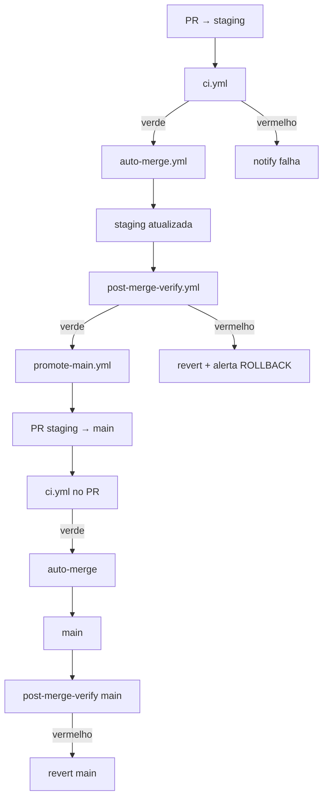

# Esteira full-auto (GitHub Actions)

Resumo para Luiz e agentes Brain (`especialista-git`, `gestor-de-risco`). Repositório: `LuizGustavoVJ/Brain-Cursor`.

## Decisão operacional

- **Sem** aprovação humana no GitHub (`required_approving_review_count: 0`).
- **Sem** `/approve` (`approve-comment.yml` removido).
- Merge quando `lint-and-test` estiver verde; alertas por e-mail e Slack.

## Ordem (test antes de “deploy”/promoção)



| Etapa | Workflow | Se falhar |
|-------|-----------|-----------|
| PR → staging | `ci.yml` | Não mergeia; notify `[FALHA CI]` |
| Merge staging | `auto-merge.yml` | Notify workflow; sem rollback (merge não ocorreu) |
| HEAD staging | `post-merge-verify.yml` | **Rollback** + `[ROLLBACK]` |
| Promoção | `promote-main.yml` | Só após pós-merge OK |
| PR → main | `ci.yml` | Não mergeia; notify (sem rollback) |
| HEAD main | `post-merge-verify.yml` | **Rollback** em `main` |

## Rollback automático

### Quando executa

Após **cada push** em `staging` ou `main` (tipicamente merge), o job `lint-and-test-pos-merge` roda os mesmos scripts do CI.

Se falhar e o commit **não** for já um `ci-rollback:`:

1. `git revert` do HEAD (merge commit usa `-m 1`).
2. Mensagem: `ci-rollback: falha pós-merge em <branch> — revert automático`.
3. Push na branch.
4. E-mail/Slack: **`[ROLLBACK] CI pós-merge falhou em <branch> — revert executado`**.

Se falhar **de novo** em commit de rollback → alerta **`[CRÍTICO]`** (sem segundo revert).

### Passo a passo manual (se automação falhar)

```bash
git fetch origin
git checkout staging   # ou main
git log -1 --oneline
# Se merge commit:
git revert -m 1 <sha-merge>
# Senão:
git revert <sha>
git push origin staging
```

### Limites (gestor-de-risco)

| Reversível aqui | Não reversível |
|-----------------|----------------|
| Commits neste repo | Deploy em servidor externo |
| Histórico GitHub | Migração de banco já aplicada |
| Branch `staging`/`main` | E-mail/Slack/integração já enviados |
| Harness Cursor no repo | Artefatos em outros sistemas |

Reversão de **deploy** e estratégia em produção real → acionar agente **`gestor-de-risco`** (gatilho `irreversivel`).

## Notificações

Secrets: ver `docs/operacao-repositorio.md`. Destinatário exemplo: `finotello22@hotmail.com` (`NOTIFY_EMAIL_TO`).

| Evento | Prefixo |
|--------|---------|
| CI falhou no PR | `[FALHA CI]` |
| CI OK no PR | `[CI OK]` |
| Merge staging/main | `[MERGE]` / `[PROMOÇÃO]` |
| Workflow quebrou | `[ERRO WORKFLOW]` |
| Rollback | `[ROLLBACK]` |
| Pós-rollback ainda vermelho | `[CRÍTICO]` |

## Configuração uma vez

```bash
GITHUB_REPOSITORY=LuizGustavoVJ/Brain-Cursor bash scripts/apply-branch-protection.sh
```

- `allow_auto_merge=true` no repo.
- Actions: **Read and write** + permitir criar/aprovar PRs (promoção). Sem isso, `merge-staging-pr` retorna 403.

## Bootstrap em `main` (workflow_run)

O workflow `auto-merge.yml` dispara por `workflow_run` e o GitHub carrega a definição da **default branch (`main`)**. Até os workflows novos estarem em `main`, o listener antigo (`Auto-merge after approval`) ignorava CI verde — ex.: PR #8 mergeado manualmente em staging.

**Procedimento (BCGE-18):**

1. Garantir conteúdo em `staging` (incl. `post-merge-verify`, `auto-merge after CI`, sem `approve-comment.yml`).
2. Abrir PR **`staging` → `main`** e aguardar `lint-and-test` no PR.
3. Mergear o PR de promoção **uma vez** via `gh pr merge` (ou botão) se o auto-merge ainda não estiver ativo em `main`.
4. A partir daí, `workflow_run` + job `merge-staging-pr` em `ci.yml` cobrem PRs seguintes.

**Reforço:** `ci.yml` inclui job `merge-staging-pr` (após `lint-and-test`) para PRs → `staging`, reduzindo dependência só da versão em `main`.

## Skill Brain

`.cursor/skills/github-actions-cicd/SKILL.md` — propaga para `especialista-git`; rollback estratégico → `gestor-de-risco`.