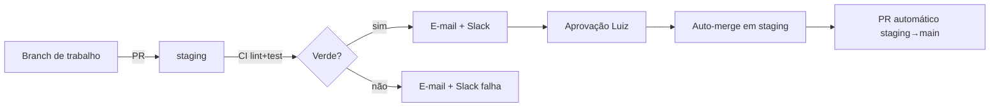

# Operação do repositório Brain-Cursor (GitHub)

Este documento descreve o fluxo de branches do Brain reconciliado com CI/CD no GitHub Actions.

## Modelo de branches

| Branch | Papel |
|--------|--------|
| `main` | Produção / referência estável do harness |
| `staging` | Integração — **todo PR de feature mira aqui** |
| `<card>_release` | Recorte a partir de `main` atualizada (regra Brain em `.cursor/frota/regras.md` §3) |

### Branches permanentes vs temporárias

No GitHub deste repositório ficam só **`main`** e **`staging`** de forma contínua. Branches de PR
(`<card>_…`, `feat/…`, `cursor/…`) são **temporárias**: ao mergear o PR, a head branch é **apagada**
(`delete branch on merge` habilitado nas configurações do repo). Não mantenha branch de feature
aberta após o merge; o histórico fica no PR e nos commits em `staging`/`main`.
| `<card>_<descricao>` | Trabalho do card a partir da release — **nunca** nascer de `staging` |
| `<card>_etapa_N_staging_<desc>` | Só para conflitos de MR **contra** staging, sem merge de staging na branch do card |

Regras críticas (AGENTS.md e `usuario/memoria/git-fluxo-cit.md`):

- **Staging nunca entra na branch do card** — proibido `git merge origin/staging` na branch de trabalho ou release.
- Ordem card_release: `main` → push release vazia → branch de trabalho da release.
- No **Brain-Cursor** (este repo), homologação = `staging`; promoção para `main` é **PR automático** `staging` → `main` após merge em staging.

### Aprovação no GitHub (não clique em Merge)

O GitHub sempre mostra o botão **Merge**, mas com proteção de branch ele fica **desabilitado** até CI verde + **1 Approve**.

**Sua ação (repositório solo):** o GitHub **não** deixa o autor marcar **Approve** no próprio PR. Com CI verde, comente no PR:

`/approve`

O workflow `approve-comment.yml` faz o merge. **Não** use *Merge pull request* manualmente, salvo emergência.

(O workflow `auto-merge.yml` por review continua útil se outro usuário for revisor no futuro.)

## Fluxo CI/CD



| Workflow | Gatilho | Função |
|----------|---------|--------|
| `ci.yml` | PR/push em `staging` | `scripts/ci-lint.sh`, `scripts/ci-test.sh` |
| `notify.yml` | CI concluído (PR) | Notifica e-mail + Slack |
| `auto-merge.yml` | Review `approved` (Luiz) | Merge automático via API após checks |
| `promote-main.yml` | Push em `staging` | Abre/atualiza PR `staging` → `main` |

Check de status obrigatório sugerido: **`lint-and-test`** (job do workflow CI).

Proteção de branch: `bash scripts/apply-branch-protection.sh` (requer `gh` com permissão admin no repo).

**Settings → Actions → General:** permissões **Read and write** e marque **Allow GitHub Actions to create and approve pull requests** (senão `promote-main` falha com `createPullRequest`).

## Secrets obrigatórios (Settings → Secrets → Actions)

| Secret | Uso |
|--------|-----|
| `NOTIFY_EMAIL_TO` | Destinatário (ex.: `finotello22@hotmail.com`) |
| `SMTP_SERVER` | Host SMTP (ex.: `smtp.office365.com`) |
| `SMTP_PORT` | Porta (ex.: `587`) |
| `SMTP_USERNAME` | Usuário SMTP ou caixa de envio |
| `SMTP_PASSWORD` | Senha ou app password |
| `SMTP_FROM` | Endereço From autorizado |
| `SLACK_WEBHOOK_URL` | Incoming Webhook do canal de code review |

`GITHUB_TOKEN` é padrão do Actions; workflows de merge/promoção pedem `contents: write` e `pull-requests: write`.

### Alternativa: Microsoft Graph (não implementada no workflow)

Para envio sem SMTP, configure app no Entra ID com `Mail.Send` e adapte `notify.yml` (client credentials). Secrets típicos: `AZURE_TENANT_ID`, `AZURE_CLIENT_ID`, `AZURE_CLIENT_SECRET`, `GRAPH_MAIL_FROM`, `NOTIFY_EMAIL_TO`. O BCGE-12 entrega **SMTP**; Graph fica documentado como extensão.

## Slack — canal manual

MCP Slack não é obrigatório. Passos:

1. No Slack do workspace Solides/CIT, crie o canal **Code Review - Aprovação de PR** (público ou privado conforme política).
2. **Apps → Incoming Webhooks** → adicione ao canal → copie a URL.
3. Grave como secret `SLACK_WEBHOOK_URL` no repositório.

Mensagens usam o mesmo texto do e-mail (assunto “PR para aprovar” quando CI verde; prefixo `[FALHA CI]` quando falha).

## Template de PR

`.github/pull_request_template.md` pede **URL do card ADO** e título. O workflow `notify.yml` parseia:

- Card na branch: `167697_...` ou `feat/bcge-12-...`
- URL no corpo: campo “Card ADO URL” ou link `dev.azure.com/.../_workitems/edit/<id>`

## Comandos locais

```bash
bash scripts/ci-lint.sh
bash scripts/ci-test.sh
GITHUB_REPOSITORY=LuizGustavoVJ/Brain-Cursor bash scripts/apply-branch-protection.sh
```

## Limitações conhecidas

- `bash .cursor/scripts/frota.sh lint` valida modelos Cursor legados (`haiku|sonnet|...`) e **falha** no estado atual; o CI usa lint estrutural em `ci-lint.sh`. Atualizar `frota.sh` é demanda separada.
- Auto-merge exige **Allow auto-merge** habilitado no repositório (Settings → General).
- PR de promoção `staging` → `main` pode exigir ajuste de proteção em `main` (`apply-branch-protection.sh` usa 0 revisões em `main` por padrão).